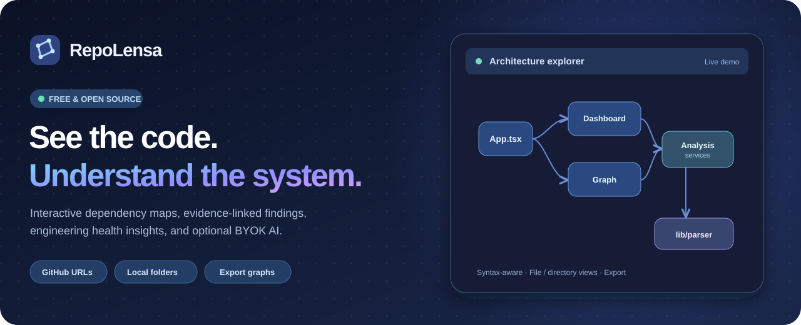

<div align="center">



### See the code. Understand the system.

**Free, open-source codebase visualization and evidence-based architecture analysis.**

[](https://github.com/amnansyahmi/RepoLensa-AI/actions/workflows/ci.yml)
[](https://github.com/amnansyahmi/RepoLensa-AI/releases)
[](LICENSE)
[](https://github.com/amnansyahmi/RepoLensa-AI/stargazers)

**[🚀 Try the live demo](https://repolensa-ai.vercel.app)** · **[⚡ Quick start](#quick-start)** · **[🧭 Roadmap](docs/ROADMAP.md)** · **[🤝 Contribute](CONTRIBUTING.md)** · **[🔐 Security](SECURITY.md)**

</div>

## Why RepoLensa?

A codebase is easier to improve when you can **see the relationships** between modules and projects. RepoLensa helps developers, reviewers, students, and maintainers navigate an unfamiliar codebase without requiring a paid SaaS subscription or uploading private code to an analysis service.

## Explore the demo

RepoLensa opens with a built-in public sample, so you can test the architecture explorer **without an API key, GitHub account, or uploading your own code**. Choose **See demo**, select a dependency node, inspect its source, and review the file-linked health findings.



<sub>Source-grounded illustration from <code>src/demo.ts</code>: 10 sample files and 12 relative-import connections. This vector diagram is **not** a product screenshot. The <a href="docs/SHOWCASE.md">screenshot workflow</a> captures genuine browser images from the app.</sub>

**What makes RepoLensa different?** The graph is extracted from source references instead of fabricated by a language model; structural health signals show file-level evidence and their formulas; and the core analyzer stays free with cloud AI entirely optional. The <a href="docs/ROADMAP.md">roadmap</a> distinguishes shipped functionality from future Roslyn, PR-impact and editor integrations.

## Features

| Capability | What's included |
|---|---|
| **GitHub import** | Enter a public `https://github.com/owner/repo` URL; download capped source files directly from GitHub APIs |
| **Private local analysis** | Select a directory on your own device; no application backend or source uploads |
| **JS/TS semantic imports** | TypeScript compiler syntax-tree parsing: imports, re-exports, `require()`, dynamic `import()`, basic tsconfig/jsconfig paths |
| **.NET relationships** | C# `.csproj` project references and approximate `using`-namespace relationships |
| **Interactive graph** | Search, pan, zoom, minimap, file details and source preview |
| **Architecture views** | File or directory nodes; left-to-right or top-to-bottom layout |
| **Insights** | Circular dependencies, isolated files, likely entrypoints, highly referenced modules and language distribution |
| **Evidence-based health report** | Transparent structural scoring for cycles, coupling, unresolved paths, file-size and dependency-boundary indicators. Findings link to specific files. Includes an SVG radar and language ring. |
| **Markdown report** | Export reproducible recommendations, file references and the methodology behind each signal. |
| **Cloud BYOK (optional)** | Gemini or OpenRouter requests with keys supplied temporarily by the visitor. No backend proxy or key persistence. No source text transmitted, only report metadata after consent. |
| **Export** | JSON, Mermaid (`.mmd`), SVG and PNG architecture diagrams |
| **Optional local AI** | Explicitly ask a locally running Ollama model to explain graph metadata and suggest improvements; no cloud API key |
| **Open source** | MIT license, no login, CI-verified tests and production build |

## Quick start

Prerequisites: **Node.js 20.19+ or 22.12+** and npm.

```bash
git clone https://github.com/amnansyahmi/RepoLensa-AI.git
cd RepoLensa-AI
npm install
npm run dev
```

Open the local URL printed by Vite. Try the example project immediately, choose **Open local folder**, or paste a public GitHub URL such as:

```text
https://github.com/amnansyahmi/RepoLensa-AI
```

Explore **Files / Directories**, switch the graph direction, select nodes to view detail, and choose **Export graph** to save SVG, PNG, JSON or Mermaid.

For a production build:

```bash
npm run typecheck
npm test
npm run build
npm run preview
```

## Engineering health report

RepoLensa produces a **deterministic, explainable structural report** without requiring AI. Five dimensions are scored out of 100 when supporting data is available:

1. **Cycles:** detected strongly connected components in imports and project references.
2. **Coupling:** concentrated incoming links and files with many outgoing dependencies.
3. **Resolution:** the ratio of resolved to unresolved local dependencies.
4. **File size:** 300+ line modules, explicitly a size heuristic, not complexity measurement.
5. **Boundaries:** files reaching across four or more distinct directory boundaries.

Findings provide a severity estimate, the observed fact, evidence file paths and a recommended action. Click a file path to inspect it in the graph. Export the full report as Markdown.

**Never interpret these numbers as a security audit, coverage result, or objective overall code-quality measurement.** Small, sampled and unsupported repositories can skew the score. Partial imports are flagged and the report documents its limitations.

## Optional Gemini / OpenRouter BYOK

The existing local Ollama option remains available. Cloud AI is separate and only runs after the visitor enters their own key, selects a model and explicitly consents to sending **file paths, graph-derived metrics, and findings** to the selected provider.

- **OpenRouter:** create a key at https://openrouter.ai/settings/keys. `openrouter/free` is supported, subject to available free models and quotas.
- **Gemini:** create a key at https://aistudio.google.com/api-keys. The default model ID is `gemini-2.5-flash`, but it can be changed to a currently available model.
- **Privacy:** keys are held only in React component memory for the open page, never in localStorage, cookies or this repository. A "Clear key" control is provided. The browser sends the key **directly** to the provider over HTTPS in an authentication header, not in a URL.
- **Limits:** no included hosted quota or guaranteed free usage. Provider pricing/quotas apply. Browser CORS or restrictions may block API calls.
- **Security:** browser extensions, compromised pages, DevTools and provider logs may expose credentials or sent metadata. Use a restricted, low-spend key and never paste an unrestricted production key. RepoLensa does not save source code or forward it to cloud models.

The app does not implement provider-key storage, authentication or a secure cloud proxy. These can be added separately if needed.

## Supported analysis

**JavaScript / TypeScript**: `.js`, `.jsx`, `.ts`, `.tsx`, `.mjs`, `.cjs`. Local and remote `tsconfig.json` / `jsconfig.json` are read for basic paths and `baseUrl` resolution. The TypeScript compiler parses syntax without executing repository code.

**C# / .NET**: `.cs` files and `.csproj` projects. The graph visualizes direct project references and approximate relationships through namespace declarations and `using` directives.

**Important limits:** this is a *static architectural guide*, not a build or a security scanner. C# type-level/DI relationships need a Roslyn-based analyzer and are **not** represented as verified symbols. JS/TS package imports, advanced tsconfig inheritance, conditional resolution, runtime code paths and nonliteral module paths may be omitted. Regex-based .NET namespace extraction can miss or misidentify dependencies. Partial GitHub imports can leave missing links.

The analyzer never executes imported repository code.

## Optional local AI with Ollama

AI explanations are **optional**; the rest of RepoLensa works without any model. Install [Ollama](https://ollama.com), pull a model, and start the service:

```bash
ollama pull llama3.2
ollama serve
```

If Ollama is already running, don't start a duplicate service.

Open **Explain architecture with local AI** in RepoLensa, enter your installed model name, and click **Explain**. The browser sends **graph metadata only** (file paths, language types, dependency edges and metrics) to `http://127.0.0.1:11434/api/chat` — **not source text** — only when you click the button. No default third-party AI provider or API key is used.

To permit browser connections, Ollama may require `OLLAMA_ORIGINS` to include your RepoLensa site's exact origin. Example local-development configuration (set before starting Ollama):

```bash
# macOS / Linux
OLLAMA_ORIGINS=http://localhost:5173 ollama serve
```

On Windows, configure the Ollama environment variable and restart Ollama. If the site is hosted over HTTPS, browser security rules can restrict requests to a local HTTP service. In that case, run RepoLensa locally or use a compatible secure local setup. **Never expose Ollama's port publicly** just to make the feature work.

Explanations may be incorrect; verify all suggestions against actual source code.

## Privacy & limits

- **Local folder analysis** stays in browser memory. RepoLensa has no code-upload endpoint, user database, analytics SDK, account requirement or hosted model. Google Fonts may make a separate external font request; no source content is included in it.
- **GitHub import** requests public metadata and source files directly from `api.github.com` and `raw.githubusercontent.com`. Your browser contacts GitHub as expected. GitHub's unauthenticated rate limit is commonly **60 REST API requests per IP/hour**.
- **GitHub import caps:** up to **120 files**, **3 MB** total and **100 KB per file**; fallback to the blob API caps files at **35**. Large/truncated trees are rejected with an explanation. Partial imports are clearly flagged.
- **Local import caps:** up to **400 supported/config files** and **3 MB**. Your folder picker may include unsupported content, which is ignored.
- The app does **not** run source code, request GitHub credentials, or fetch arbitrary domains from pasted repository URLs.
- **Exports** contain filenames, graph relationships and summary metadata, not source code. Take care: file paths can still reveal private project structure.
- Ollama requests contain graph metadata, which may be sensitive even without source code. This feature is opt-in and only points to the local loopback host.

## Deployment

RepoLensa is a static Vite application. Deploy it from this repository using **Vercel** (Framework: Vite, Build: `npm run build`, Output: `dist`) or host the contents of `dist/` on any static provider. No hosted API service or database is required.

A local build also works completely offline for local folder browsing after its assets are loaded; hosted GitHub imports require GitHub connectivity.

## Future roadmap

See the maintained [roadmap](docs/ROADMAP.md) for priorities, open-source contribution opportunities and explicit scope boundaries.


- More accurate Roslyn-powered C# symbols, services and dependency-injection visualization
- Incremental processing and larger repository handling
- More advanced workspace/monorepo resolution and graph clustering
- VS Code extension, MCP server and offline-first PWA

The GitHub repository is now named **RepoLensa-AI**, and the public deployment is [repolensa-ai.vercel.app](https://repolensa-ai.vercel.app). Trademark availability has not been independently established.

If you want to contribute, see [CONTRIBUTING.md](CONTRIBUTING.md) and the [issue templates](.github/ISSUE_TEMPLATE). Read the [release notes](docs/RELEASE_NOTES_v1.1.0.md) for what shipped in v1.1. For security issues, see [SECURITY.md](SECURITY.md).

## License

[MIT](LICENSE) © 2026 Amnansyahmi.
